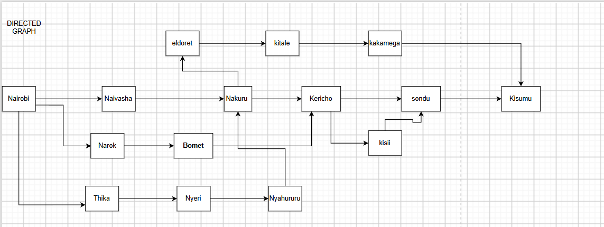
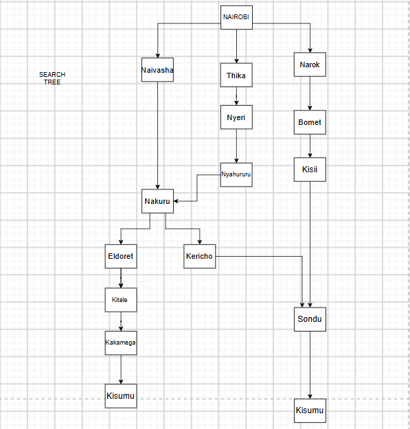

Question 2: Directed Graph and Search Tree
To solve and represent the environment and routing problem from Nairobi to Kisumu, we use the Directed Graph and a Search Tree.

1. Directed Graph (State Space)
The Directed Graph represents the physical road network and all possible legal actions such as driving.
It consists of:
Nodes: These are the major towns (Nairobi, Naivasha, Nakuru, etc.).

Edges : Directed roads connecting the towns.

2. Search Tree
The Search Tree represents how the agent explores the state space starting from the initial state (Nairobi) to find the goal state (Kisumu). It shows the different paths the agent is considering.

Root Node: Nairobi

Branches: possible routes the agent might consider (Northern, Central, Southern, and Eastern).

3. Abstraction
Abstraction involves leaving out irrelevant information to reduce the complexity of the problem.

In this specific scenario, abstraction was applied as follows:

Ignoring Minor Towns: Minor towns and villages along the routes are omitted. The agent only considers major towns (nodes) as the distance markers.

